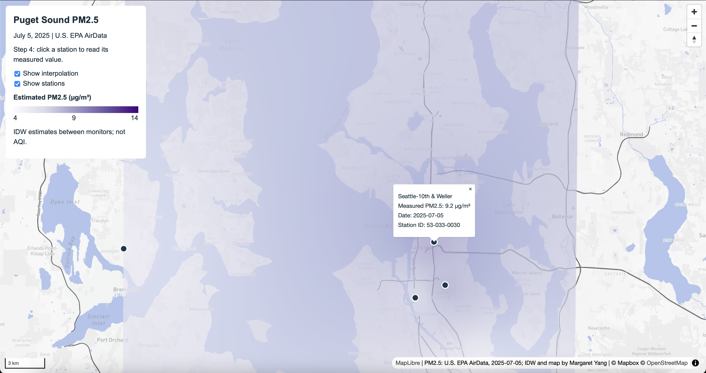
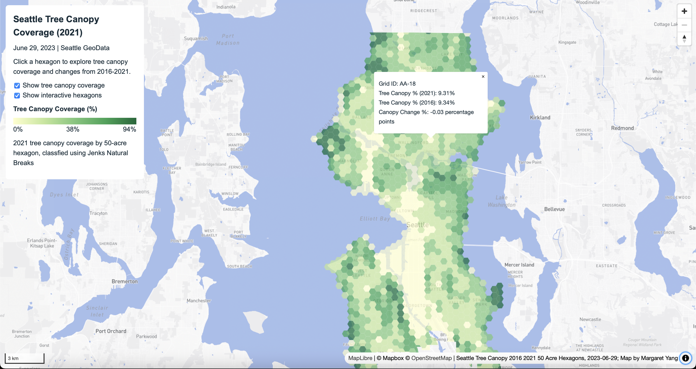

# GEOG458 Lab 03: Basemap Design and Tile Generation
## Margaret Yang
## Project Overview
This lab explores how thematic raster and interactive vector data can be combined to create web maps using QGIS, Mapbox Studio, and MapLibre GL JS. Two maps were created: a guided map visualizing PM2.5 concentrations in the Puget Sound region, and an independent map examining tree canopy coverage in Seattle. Both maps using different customized basemaps, thematic raster layers and interactive vector data.    
## Lab03-1: Puget Sound PM2.5

This guided map visualizes PM2.5 concentrations across the Puget Sound region using observations from the U.S. Environmental Protection Agency (EPA) AirData collected on July 5, 2025. The station observations were imported into QGIS and reprojected to EPSG:32610 for IDW interpolation. The resulting raster estimated PM2.5 concentrations between monitoring stations, while geojson circle layer displays individual station location and their measured values.        

This map has a customized Mapbox basemap, hiding POIs and emphasizing highways, a separately exported interpolation raster, and interactive station circles. Users can toggle the raster, vector layers, and click individual stations to view their names, measured concentrations in µg/m³, observation dates, and station IDs.         

The IDW estimated concentrations between monitor stations, and should not be interpreted as AQI values.
## Lab03-2: Seattle Tree Canopy Coverage (2021)

### Study Area, Purpose, Possible Audience
The independent map discovers the geographic distribution of tree canopy coverage across Seattle, Washington, using 50 acre hexagonal areas. The map's intended audience includes Seattle residents, urban planners, environmental NGOs, and people interested in urban green space and environmental conditions in general. It helps audiences identify areas with higher and lower tree canopy coverage, explore how canopy coverage changed between 2016 and 2021, and understand spatial patterns that could inform future urban planning and envrionmental and city envrionmental conservation efforts.
### Data Sources
The dataset, *Seattle Tree Canopy 2016-2021 50 Acre Hexagons*, was downloaded from Seattle GeoData, originally published on June 29, 2023. The dataset includes tree canopy coverage percentaged for 2016 and 2021, along with attributes describing changes over time.
### Basemap
The basemap was customized using Mapbox, using geographic data from Mapbox and OpenStreetMap. To simplify the basemap and emphasize the tree canopy distribution, I hid all road labels and selected commericial POI labels, including food and drink stores, food and drink establishments, commercial services, stores, and lodging. I also darkened the neighborhood, city and regional labels to improve their visibility and provide grographic context. I implemented the published URL in QGIS, and exported as PNG raster tiles using QMetaTiles.
### Data Processing and Visualization
The tree canopy geojson was imported into QGIS as a polygon layer. I chose *TreeCanopy_2021_Percent*, the percentage of tree canopy coverage in 2021, as the variable for visualization. I used Graduated symbology with Natural Breaks to classify the data into five classes. I used a sequential yellow - green color scheme, with lighter yellow representing lower canopy coverage, and darker green representing higher canopy coverage.      

The five classification ranges are approximately 0-13%, 13%-26%, 26%-38%, 38%-57%, and 57%-94%. After setting the color of hexagon polygons, I exported this layer as PNG raster tiles using QMetaTiles, separated than basemap tiles.      

Unlike the guided PM2.5 map, the independent map does not use interpolation. Instead, the thematic raster layer is a rasterized choropleth based on existing polygon attributes. The canopy percentages are estimates derived from remotely sensed data rather than direct measurements of individual trees.
### Raster, Vector Relationship and Interactivity
The thematic raster and geojson vector layer represent the same 50 acre hexagons but serve different purposes. The raster displays the geographic distribution of tree canopy coverage, while the vector layer provides access to the original attribute data, offers a complete and broader view of tree canopy patterns.      

I added the geojson polygons as a transparent layer above the raster, allowing users to click individual hexagons to view their grid IDs, canopy percentages for 2016 and 2021, and changes in percentage points. The map also includes a matching legend and separate controls for toggling the thematic raster and interactive vector layer.
### Raster Tile Export
Both basemaps and thematic raster layers were exported separately using QMetaTiles in QGIS, following the lab instructions. The exports used zoom levels 8-12, 256 x 256 pixels PNG tiles, and the XYZ tile scheme. The project CRS was set to EPSG:3857. The guided map covers the central Puget Sound region, while the indepedent map covers City of Seattle. The thematic layers were exported with 100% transparent backgrounds to allow them to overlay the basemaps.